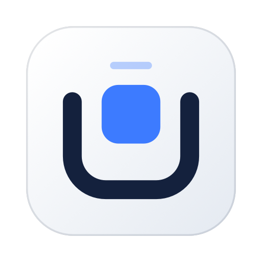
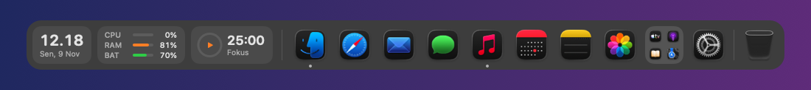

<div align="center">



# Dockway

**Dock kustom untuk Mac: app, folder, dan widget dalam satu bar.**

Gratis, tanpa akun, dan tanpa pelacakan. Tampil di tempat Dock bawaan, dan bisa diatur sesuka Anda.

[](../../releases/latest)


[**⬇ Unduh versi terbaru**](../../releases/latest/download/Dockway.dmg) · [English](#english)



</div>

---

## Fitur

| | |
|---|---|
| 🧭 **Dock** | App, folder ala iPhone, widget, dan pemisah dalam satu urutan yang bisa diatur. App yang sedang berjalan dan Trash di ujung bar |
| 📐 **Tampilan** | Di bawah, atas, kiri, atau kanan layar. Ukuran bisa disamakan dengan Dock bawaan, efek perbesaran saat kursor lewat, sembunyi otomatis, pilihan monitor |
| 🪟 **Jendela** | Preview jendela saat kursor di atas ikon app, dan badge notifikasi app |
| 🧩 **Widget** | Jam, statistik sistem, Pomodoro, konverter satuan, color picker, riwayat clipboard, kalender dan pengingat, screenshot, musik (Music dan Spotify), cuaca |
| 🛠 **Untuk developer** | Review, pull request, dan issue GitHub; issue Linear |

## Instalasi

1. Unduh `Dockway.dmg` dari halaman [Releases](../../releases/latest).
2. Buka DMG, lalu seret **Dockway** ke folder **Applications**.
3. Buka Dockway. Bar muncul di bagian bawah layar, dan ikonnya ada di menu bar.

**Persyaratan:** macOS 14 (Sonoma) atau lebih baru. Mac Intel maupun Apple Silicon.

Aplikasi ditandatangani dengan Developer ID dan dinotarisasi Apple, jadi dapat dibuka tanpa peringatan Gatekeeper. Pembaruan berikutnya dipasang lewat menu bar → **Periksa pembaruan…**.

## Hubungan dengan Dock bawaan

Secara bawaan, Dockway menyalakan auto-hide Dock bawaan selama Dockway berjalan. Saat kursor menyentuh tepi layar, Dock bawaan tetap muncul seperti biasa dan Dockway menyingkir sementara. Pengaturan asli Dock dikembalikan saat Dockway ditutup. Opsi ini bisa dimatikan di **Pengaturan**.

## Izin

Tidak ada izin yang diminta saat Dockway pertama kali dibuka. Setiap izin baru diminta saat fitur yang membutuhkannya Anda nyalakan, dan semuanya opsional:

| Izin | Dipakai untuk |
|---|---|
| Kalender, Pengingat | Widget Kalender |
| Rekaman Layar | Widget Screenshot dan preview jendela |
| Automation | Tombol putar/jeda di widget Musik |
| Lokasi | "Gunakan lokasi saat ini" di widget Cuaca |
| Accessibility | Badge notifikasi app, dan membawa jendela tertentu ke depan dari preview |

## Privasi

Tidak ada akun dan tidak ada pelacakan. Riwayat clipboard mati secara bawaan, hanya disimpan di memori, dan tidak mencatat kata sandi dari password manager.
Koneksi jaringan hanya terjadi untuk:

- pemeriksaan pembaruan (bisa dimatikan di Pengaturan);
- cuaca dari [Open-Meteo](https://open-meteo.com), setelah Anda memilih lokasi. Yang dikirim hanya nama kota yang dicari dan koordinat yang dibulatkan sekitar 1 km;
- GitHub dan Linear, setelah Anda menyambungkan token sendiri. Token disimpan di Keychain.

## Tanya jawab

<details><summary>Apakah Dock bawaan dimatikan?</summary>
Tidak. Dockway hanya menyalakan auto-hide Dock bawaan, sehingga Dock bawaan tetap bisa dipakai lewat tepi layar. Kalau Dockway ditutup paksa dan Dock bawaan tetap tersembunyi, pulihkan dengan perintah ini di Terminal:

```sh
defaults write com.apple.dock autohide -bool false && defaults delete com.apple.dock autohide-delay; killall Dock
```
</details>

<details><summary>Tombol "Izinkan akses" tidak memunculkan dialog. Kenapa?</summary>
Kalau izin itu pernah ditolak, macOS tidak bertanya lagi. Nyalakan Dockway di Pengaturan Sistem → Privasi & Keamanan, pada bagian izin yang bersangkutan. Untuk Rekaman Layar, buka ulang Dockway setelahnya.
</details>

<details><summary>Musik dari browser atau YouTube tidak muncul.</summary>
Widget Musik saat ini mendukung Music dan Spotify.
</details>

## Masukan dan bug

Temukan bug atau punya ide? Buka [Issues](../../issues) dan sertakan versi macOS, versi Dockway, serta langkah untuk mengulangnya.

---

## English

**Dockway is a custom dock for your Mac**: apps, iPhone-style folders, and widgets in one bar that takes the place of the built-in Dock.

- **Download:** get `Dockway.dmg` from [Releases](../../releases/latest), open it, and drag **Dockway** to **Applications**.
- **Requirements:** macOS 14 or later, Intel or Apple Silicon.
- **Security:** signed with a Developer ID and notarized by Apple.
- **Permissions:** none at first launch; each one is requested only when you turn on the feature that needs it.
- **Privacy:** no accounts, no tracking. Network access is used only for update checks, weather (Open-Meteo) once you pick a location, and GitHub/Linear once you connect your own token.
- **Feedback:** open an [issue](../../issues).

---

<div align="center"><sub>© 2026 <a href="https://andridesmana.dev">Andri Desmana</a></sub></div>
# dockway-public
